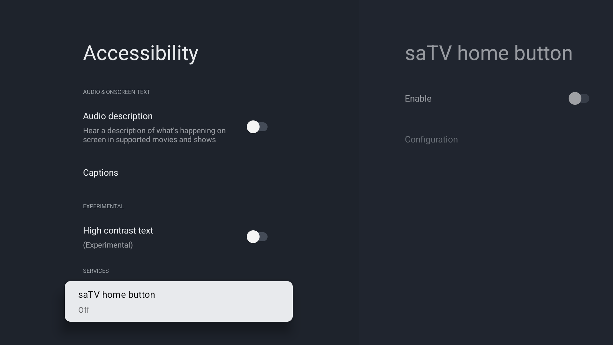
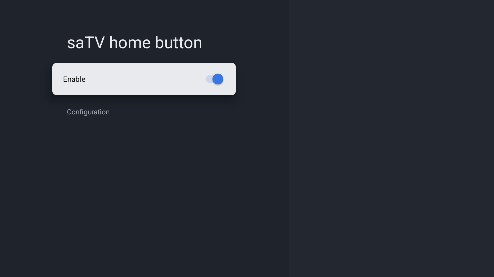

# Install saTV on your TV

You need an **Android TV or Google TV running Android 9 or newer**, an Android phone or computer, and the
saTV `.apk` file. Put both devices on the same home network. ADB is Android's tool for sending the APK to
the TV. For a first try, install the APK and open saTV from your TV's apps.

[Install from an Android phone](#install-from-an-android-phone) · [Install from a computer](#1-get-the-two-downloads)

## Install from an Android phone

1. Download the saTV `.apk` from [saTV Releases](https://github.com/kcmaker10/satv/releases) to your phone.
   Install [Tellyscope](https://github.com/man15h/tellyscope#readme) on the phone.
2. On your TV, enable [Developer options and network debugging](#2-connect-to-the-tv). In Tellyscope,
   choose **Add your TV**, select your TV, and follow the pairing prompt. If discovery misses your TV,
   use **Add by IP address** with the address and port shown by your TV. Approve the matching key on the TV,
   or enter the pairing code if prompted.
3. On Tellyscope's **Overview** screen, tap **Install app**. Pick the saTV APK from **Downloads**, check
   that the confirmation says **saTV**, and tap **Install**.
4. Open saTV on the TV. To have the remote's Home button open it, follow
   [the Home button helper steps](#4-turn-on-the-features-you-want). Tellyscope's **Install app** tool is all
   you need for this route.

If your TV's debugging connection can't pair with the phone, try the computer steps below.

## 1. Get the two downloads

1. On your computer, open [saTV Releases](https://github.com/kcmaker10/satv/releases). Under **Assets**, download the saTV file ending
   in `.apk`. If you don't see an APK there, the public download isn't available yet.
2. Download the [Android SDK Platform-Tools ZIP](https://developer.android.com/tools/releases/platform-tools)
   for Windows, Mac or Linux, then extract it. Open the extracted `platform-tools` folder. It should contain
   `adb.exe` on Windows or `adb` on Mac and Linux.
3. Move the APK into that folder and name it `satv.apk`. If your computer hides file extensions, rename
   the visible part to `satv` so it keeps a single `.apk` ending.
4. **Windows** — In File Explorer, click the address bar while you're in `platform-tools`, type `powershell`
   and press **Enter**. Copy the commands below into that window and press **Enter** after each one.
   **Mac or Linux** — Open Terminal, type `cd` followed by a space, drag the `platform-tools` folder into
   Terminal, then press **Enter**. Use `./adb` in place of `./adb.exe` in every command below.

## 2. Connect to the TV

On the TV, open **Settings → System → About** or **Settings → Device Preferences → About**. Highlight
**Android TV OS build** or **Build** and press **OK** seven times to turn on **Developer options**. Go back
one screen and open **Developer options**. Menu names can vary by TV. [Android TV setup help](https://developer.android.com/training/tv/get-started/create#run-on-a-physical-device)

**If you see Wireless debugging**

1. Turn it on, choose **Pair device with pairing code**, and leave the code on screen.
2. Copy the address and port from that pairing screen. The numbers below are an example. When prompted,
   type the code from your TV and press **Enter**.

   ```powershell
   ./adb.exe pair 192.168.1.50:37123
   ```

3. Go back to the main **Wireless debugging** screen and read **IP address & port** there. Use that address
   and port for the connection. The pairing and connection ports can differ.

   ```powershell
   ./adb.exe connect 192.168.1.50:39745
   ```

**If you see Network debugging or USB debugging**

Turn on **Network debugging** if available, or **USB debugging** if your TV supports ADB over the network
with that switch. Find the TV's IP address under **Network & Internet** or **About → Status**. Replace the
example IP below with yours. Use the port shown by your TV, or try `5555` if it shows none. Approve the
debugging prompt on the TV if one appears.

```powershell
./adb.exe connect 192.168.1.50:5555
```

Check the connection before installing.

```powershell
./adb.exe devices
```

You should see one row with your TV's address and the word `device`. If another device is listed, disconnect
it first. If your TV says `unauthorized`, approve the prompt with the remote and run the check again.
[Google's ADB connection guide](https://developer.android.com/tools/adb#connect-to-a-device-over-wi-fi)

## 3. Install and open saTV

```powershell
./adb.exe install -r satv.apk
```

Wait for **`Success`**, then find **saTV** in the TV's apps list and open it. Try pressing **Down** from the
dock to see all your apps. Wallpapers, profiles, folders and the manual **Ambient** button are ready to try.
The same command installs newer official APKs signed with the same key and keeps your saTV settings.

## 4. Turn on the features you want

**Use the remote's Home button.** In saTV, open **Settings (the gear) → General → Home button helper**.
In the TV's Accessibility settings, select **saTV home button**, turn on **Enable**, and confirm. Press
**Home** to check that it opens saTV. Some Google TVs briefly show their own Home screen first.

| Find **saTV home button** under **Services** | Turn on **Enable** |
| --- | --- |
|  |  |

| If you want… | On your TV |
| --- | --- |
| Now Playing or local Continue Watching | Choose **Turn on Notification access** on saTV Home if shown. You can also look for **Notification access** in the TV's app settings. Select **saTV** and confirm. |
| Aura's audio-reactive effects | In the TV's **Settings → Apps → saTV → Permissions → Microphone**, choose **Allow only while using the app** if available. Android uses this permission for access to the audio effects feed. |
| saTV as the system screensaver | Try **Ambient** from the saTV gear first. If your TV's **Screensaver** picker lists **saTV Ambient**, note your current choice and select **saTV Ambient**. Some Google TVs don't expose this picker. |
| System-wide ad blocking or automatic Home-button helper repair | These use an optional Android secure settings grant over ADB. The basic setup works with that permission off. |

After setup, you can turn off debugging in **Developer options**. Repeat the connection step when you want
to install an update.

## Go back to your original Home

1. Open the TV's **Accessibility** settings and switch off **saTV home button**. If you also changed
   the TV's default Home app, select your original one again in **Default apps → Home app**, if available.
2. If you changed the system screensaver or enabled ad blocking, restore your previous screensaver and DNS
   settings before uninstalling.
3. To remove saTV and its local settings, use the TV's **Settings → Apps → saTV → Uninstall**.

## If you get stuck

| What you see | What to try |
| --- | --- |
| `adb.exe` isn't found | Check that PowerShell is open inside the extracted `platform-tools` folder. |
| Connection refused, or the TV is missing from `devices` | Check that the TV is awake, debugging is on, and both devices are on the same home network. With Wireless debugging, use the port on the main screen for `connect`. Some guest networks block devices from seeing each other. |
| `satv.apk` can't be found | Check that the APK is in `platform-tools` and that the real filename is `satv.apk`. |
| `INSTALL_FAILED_UPDATE_INCOMPATIBLE` | An installed copy was signed with a different key. Keep it until you've decided whether to uninstall it and lose its local data. You can back up profiles and settings under **saTV Settings → General → Back up** first. |
| **Restricted setting** when enabling a switch | On supported TVs, open **Settings → Apps → saTV → App info → More → Allow restricted settings**. Review the access Android describes before you confirm. [Android's restricted settings help](https://support.google.com/android/answer/12623953) |
| **App blocked to protect your device** or `INSTALL_FAILED_VERIFICATION_FAILURE` | The TV-only SAI install hit this in our Android 14 Google TV emulator. ADB installed the same signed APK with Play Protect on. If you already used ADB and still see this, share your TV model, Android version and the full error in a support report. |
