<h1 align="center">
  
</h1>

<strong>A free, ad-free home screen for Android TV and Google TV.</strong>

  <a href="https://github.com/kcmaker10/satv/releases/latest"><strong>Get saTV</strong></a> ·
  <a href="#screenshots">Screenshots</a> ·
  <a href="#feature-guide">Features</a> ·
  <a href="#install">Install guide</a> ·
  <a href="#permissions-and-privacy">Privacy</a>

Resume your next episode from Home with full-screen artwork and progress. Keep your favourite apps in an animated glass dock, give each person their own PIN-locked profile, and turn the idle screen into a parallax photo gallery or a music display with synced lyrics and seven visualizers.

**Every feature is free.** saTV has no launcher ads, analytics, paid unlocks, or saTV account. Local playback history stays on your TV.

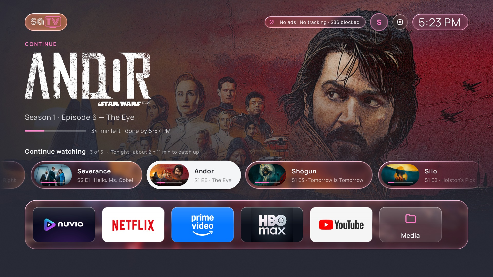

*Captured in the Dracula theme on an Android TV demo setup.*

## Screenshots

### Continue Watching

Move across the row to change the full-screen backdrop, title logo, and episode details. Choose **Trakt, Simkl, MDBList, or WeTrakr** for each profile. Tracker cards with matching IDs can open in Nuvio. **Watched on this TV** works on its own and reopens the app that reported playback.

| **Trakt and title artwork** | **Local history with Trakt off** |
| --- | --- |
|  |  |

#### Episode details and source settings

| **Episode progress** | **Per-profile tracker selector** |
| --- | --- |
| 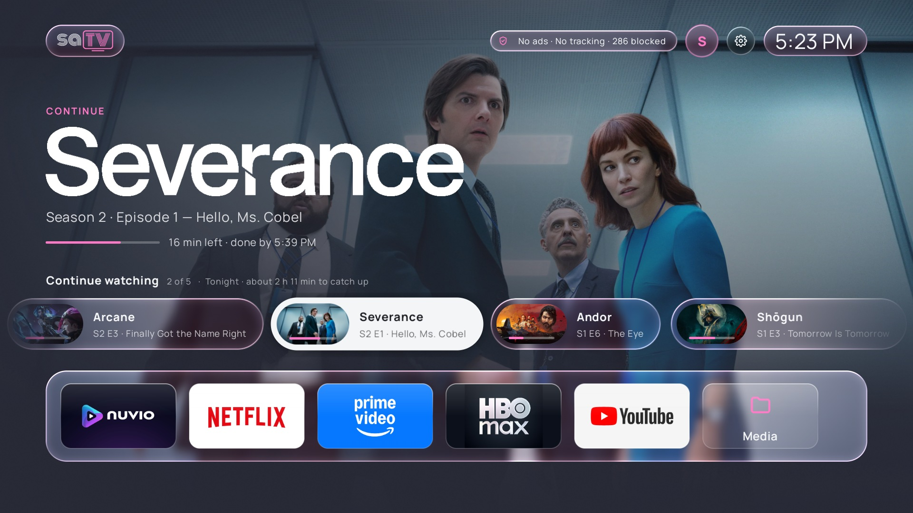 | 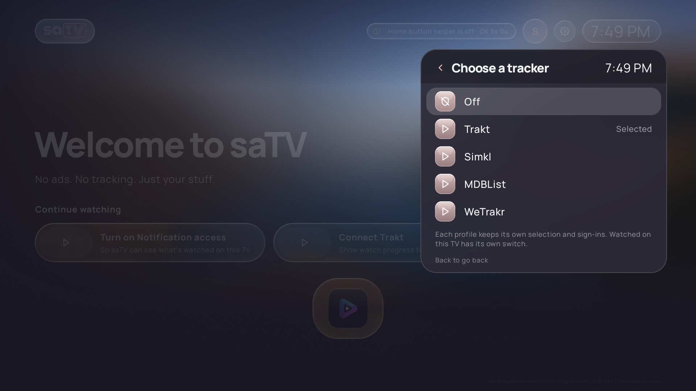 |

### Home, apps, and PIN-locked profiles

Press **Down** from the glass dock to open All Apps. Pin your favourites, group apps in animated folders, and hide apps per profile.

**Give everyone their own Home on one TV.** Each profile can choose its own tracker and account, decide whether to show local playback history, and keep that history separate. Everyone can arrange their apps and folders, pick a wallpaper and theme, and protect their profile with an optional four-digit PIN.

| **All Apps** | **Animated folders** |
| --- | --- |
| 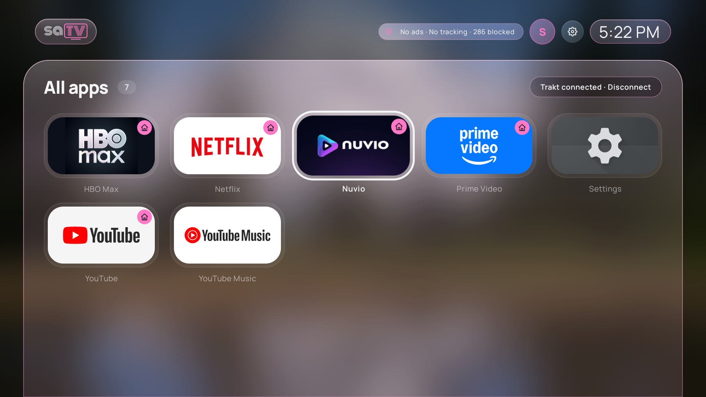 | 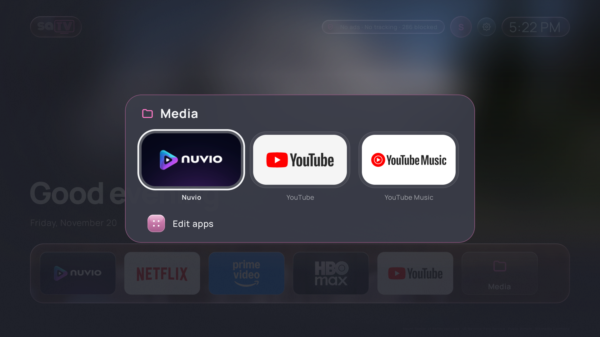 |

| **PIN-locked profile** | **Enter PIN to switch** |
| --- | --- |
| 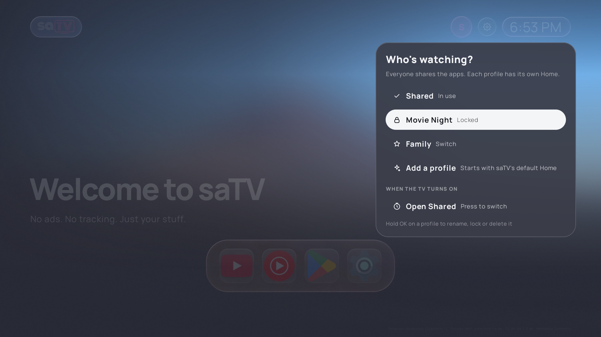 | 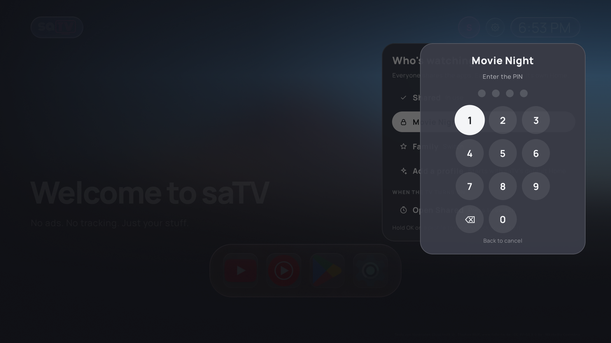 |

#### Profiles and appearance settings

| **Profile switcher** | **Theme, glass, and fonts** |
| --- | --- |
| 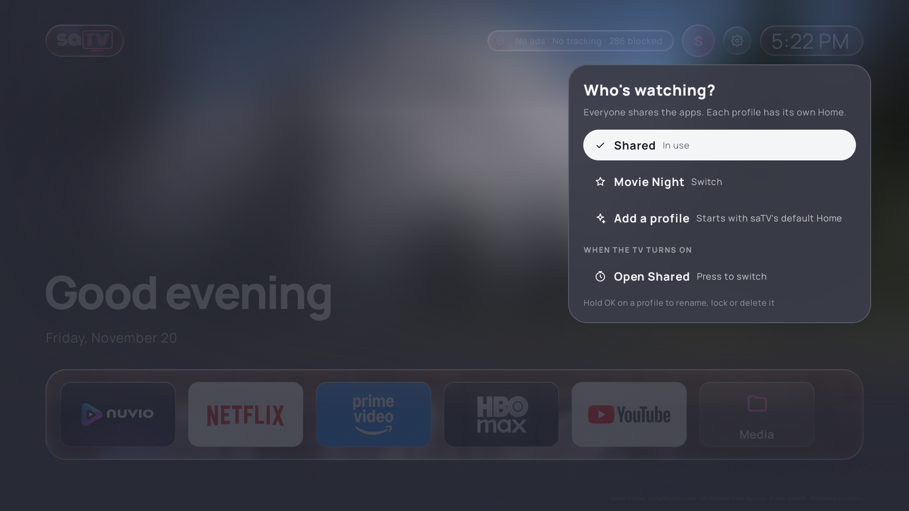 | 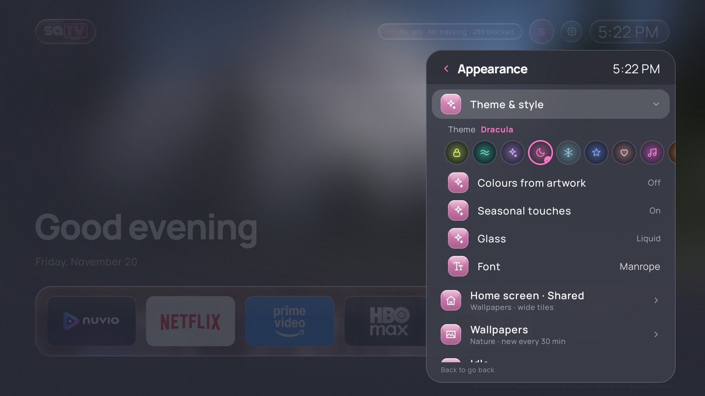 |

### Now Playing and synced lyrics

See the current track in the **Now Playing** chip on Home. Press **OK** for album art and playback controls. In Ambient, follow timed lyrics when available.

| **Now Playing chip** | **Synced lyrics** |
| --- | --- |
| 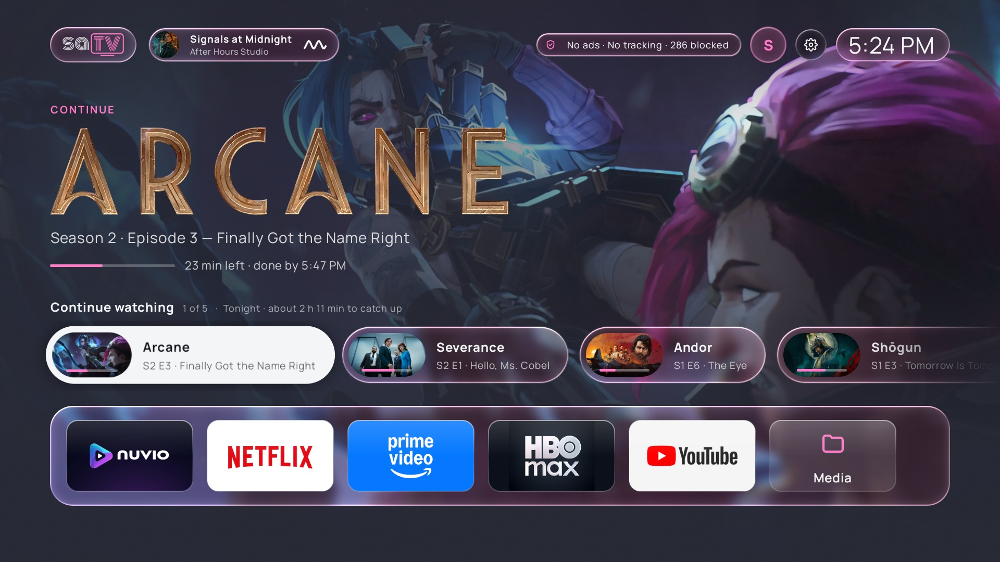 | 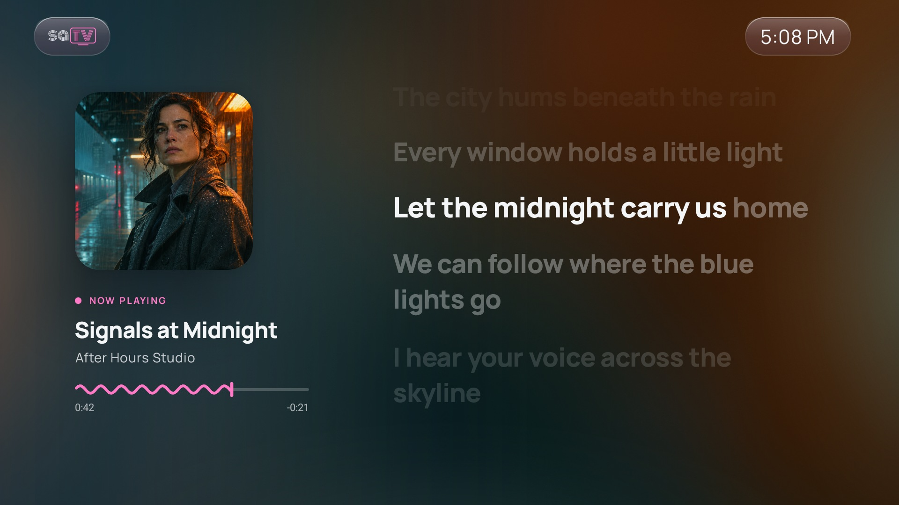 |

#### Expanded playback controls

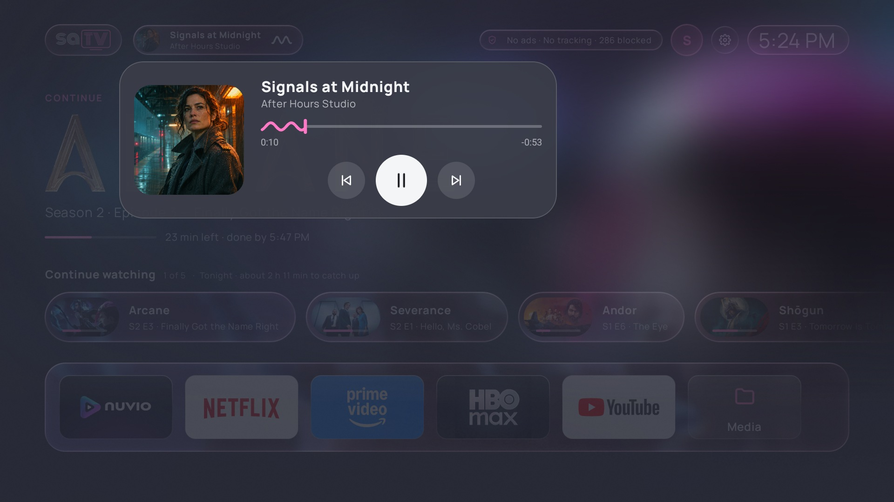

### Aura music visualizer

Choose from seven audio-reactive looks: **Ribbons**, **Silk**, **Retro TV**, **Neon signal**, **Bubbles**, **Birds at dusk**, and **Waterfall**.

| **Retro TV** | **Ribbons** |
| --- | --- |
|  | 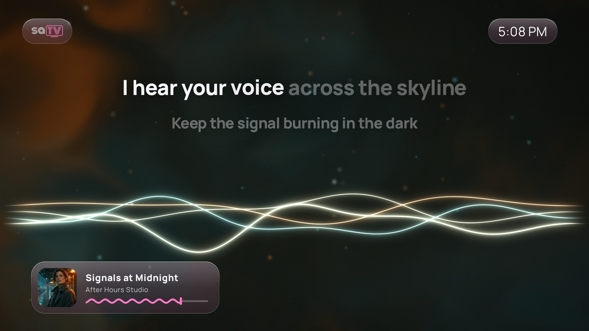 |

#### Waterfall visualizer

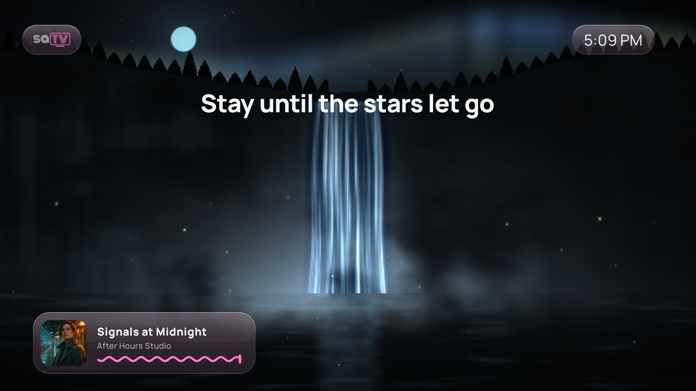

### Wallpapers and photo Ambient

Choose a rotating photo collection from Wikimedia Commons or NASA. Photo Ambient defaults to gentle parallax and has eight built-in photos for offline rotation.

| **Photo wallpapers** | **Photo Ambient** |
| --- | --- |
|  | 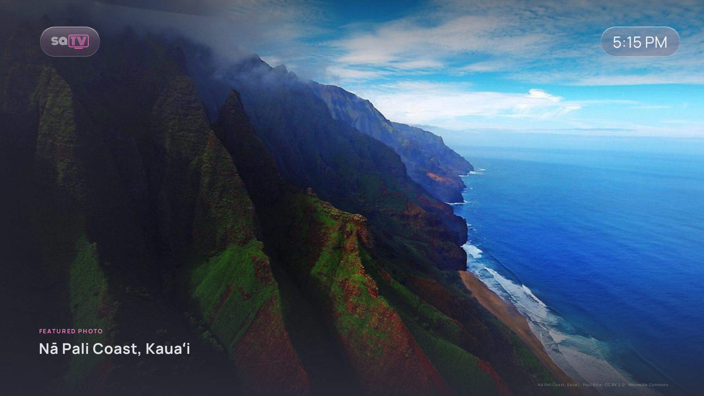 |

### Quick settings and DNS

The gear puts Wi-Fi, Bluetooth, Ambient, and optional system-wide DNS blocking within reach. With NextDNS set up, the stats panel shows blocked queries, top trackers, and a seven-day chart.

| **Quick settings** | **NextDNS dashboard** |
| --- | --- |
| 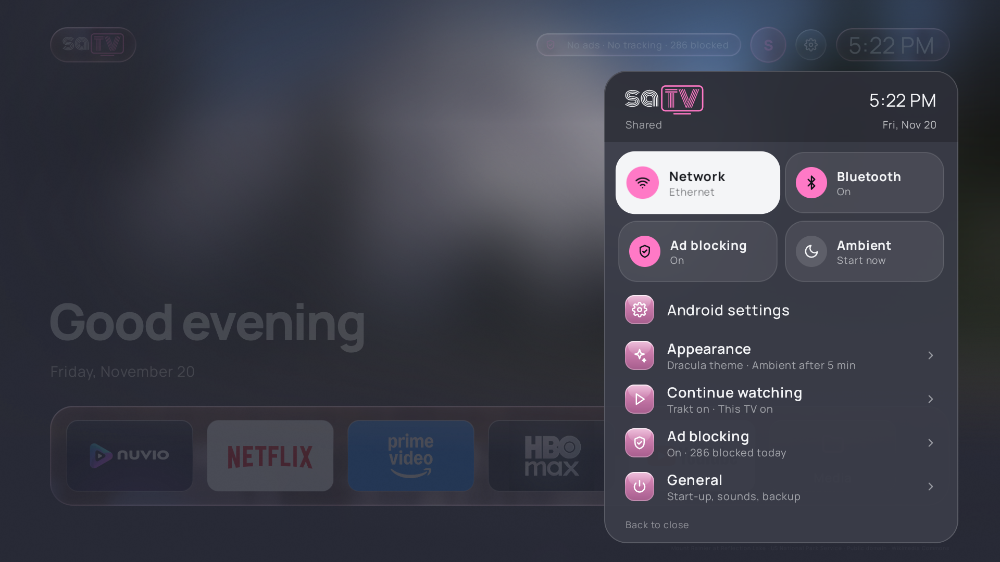 | 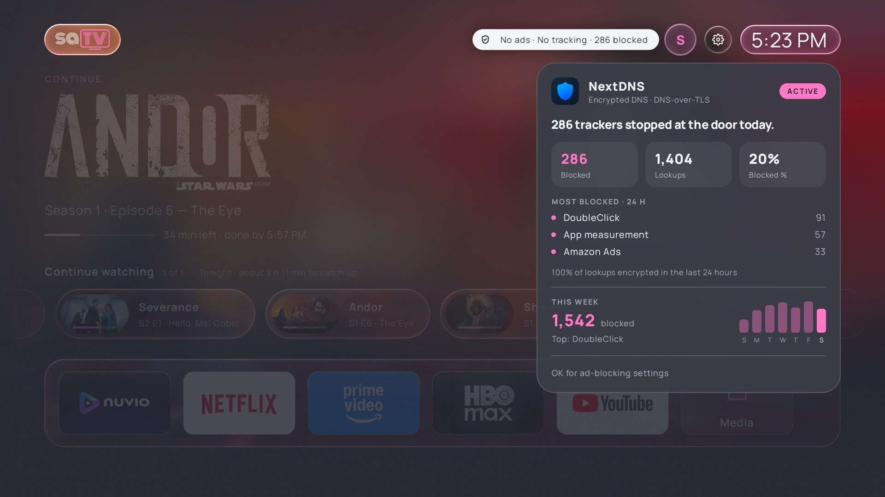 |

#### Pause blocking for apps that need it

If DNS blocking interferes with an app, hold **OK** on its tile and choose **Pause ad blocking in this app**. With the Home button helper enabled, saTV pauses blocking while that app is on screen and resumes it when you leave.

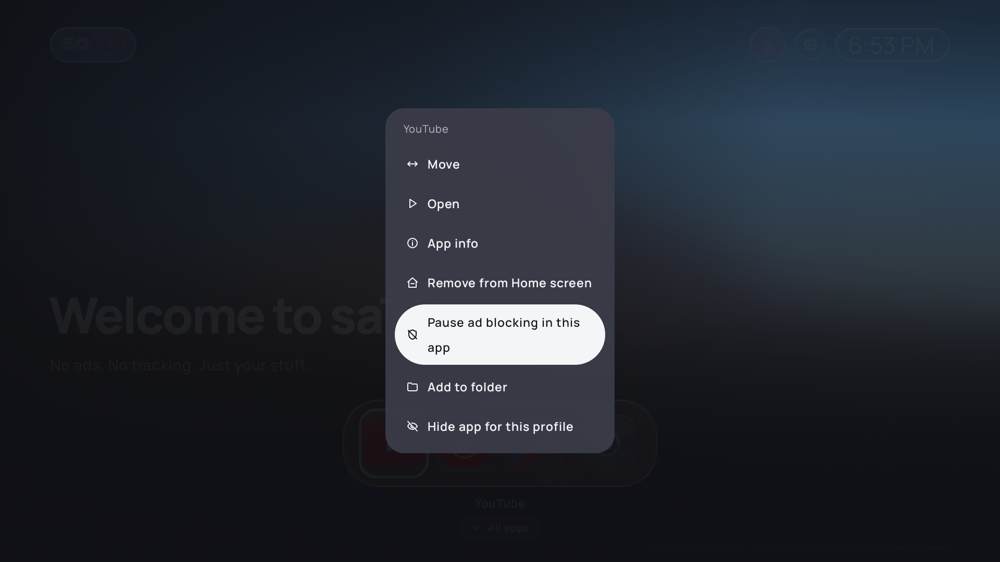

## Feature guide

- **Make your next episode the centrepiece.** Browse full-screen backdrops, title logos, progress, and time remaining right from Home. Connect the tracker of your choice with your own Client ID and optionally show local playback history from supported apps. With Nuvio installed, supported tracker cards can open the matching movie or episode. Add your own TMDB key under **Continue watching → Artwork**.
- **Put your favourite apps one press away.** Keep them in a glass dock with app icons or wide banners. Press **Down** to open All Apps and hold **OK** to pin, reorder, group, or hide apps. Restore hidden apps from **Settings → Hidden apps**.
- **Set up a shared TV for everyone.** Select the profile circle to switch. Hold **OK** on a profile to rename it or add a PIN. Set which profile opens at startup in the same menu.
- **Make the idle screen worth looking at.** Rotate photos from Wikimedia Commons or NASA with parallax or slow zoom. Eight built-in photos keep rotating offline. When music is playing, Ambient can show synced lyrics or seven Aura visualizers. Use the Now Playing chip to control supported players from Home.
- **Tune the look and feel.** Pick from ten themes, change the font and dock size, and choose an interface sound or wake-up intro. Liquid glass adds depth on supported Android 13+ TVs. Frosted glass works on older TVs.
- **Pause DNS blocking when an app needs it.** Set an exception from the app's hold-OK menu, or pause blocking on a timer from the gear. The Home button helper makes per-app pauses automatic.
- **Check for new releases.** Open **Settings → About & updates** for the GitHub link, a manual version check, and optional update alerts.
- **Save your setup.** Find manual and scheduled backups under **Settings → General** to save your profiles and launcher settings.

## Install

saTV runs on **Android TV and Google TV with Android 9 or newer**. Get the signed APK, checksums, and matching GPLv3 source from [GitHub Releases](https://github.com/kcmaker10/satv/releases/latest).

| Install with | What you need |
| --- | --- |
| [Android phone](INSTALL.md#install-from-an-android-phone) | Tellyscope on your phone and network debugging on the TV |
| [Computer](INSTALL.md#1-get-the-two-downloads) | Google's Android Platform-Tools and an ADB connection to the TV |
| [AI agent](AGENT_INSTALL.md) | The agent guide and the same computer setup |

Once installed, open **saTV** from your TV's app list. To use it as your Home screen, enable the [optional Home button helper](INSTALL.md#4-turn-on-the-features-you-want). The guide also covers [returning to your original Home](INSTALL.md#go-back-to-your-original-home).

## Permissions and privacy

The launcher, dock, folders, profiles, and photo Ambient are ready to try after installing. Turn on extra access for the features you use.

| Access | What it's for |
| --- | --- |
| **Accessibility** | The optional Home button helper detects the remote's Home press and the foreground app for features like per-app DNS pausing. |
| **Notification access** | Now Playing and local watch history receive playback metadata from Android media sessions. |
| **Microphone permission** | Android requires this permission for Aura's playback-audio effects. saTV uses the TV's audio output for the visualizer. |
| **Secure settings via ADB** | Optional system-wide DNS controls and automatic Home button helper repair. |
| **Location and nearby devices** | Optional access for showing the Wi-Fi network and connected Bluetooth device names. |

saTV has no launcher ads, analytics, or saTV account. Local playback history stays on the TV and can be cleared from Continue Watching. Trackers, artwork, online wallpapers, weather, lyrics, and DNS features connect to their respective services when used. The optional update checker connects to GitHub. DNS blocking starts off.

## Credits

saTV was developed with assistance from Claude and OpenAI Codex.

saTV builds on trbrnt's Veil, licensed under the GNU GPL v3. [Veil on GitHub](https://github.com/trbrnt/Veil) · [GPL v3](https://spdx.org/licenses/GPL-3.0-only.html)

- **Watch artwork and progress.** Artwork and logos use TMDB. Continue Watching supports Trakt, Simkl, MDBList, and WeTrakr. saTV is independently maintained. [TMDB](https://www.themoviedb.org) · [Trakt](https://trakt.tv)
- **Photos, lyrics, and weather.** Wallpaper credits appear on the TV. Timed lyrics come from LRCLIB, and weather from Open-Meteo. [Wikimedia Commons](https://commons.wikimedia.org) · [NASA Image Library](https://images.nasa.gov) · [LRCLIB](https://lrclib.net) · [Open-Meteo](https://open-meteo.com)
- **Theme and type.** The Dracula gallery uses the Dracula palette. saTV uses Manrope for the interface and Monoton for the wordmark. [Dracula](https://draculatheme.com) · [Manrope](https://github.com/sharanda/manrope) · [Monoton](https://fonts.google.com/specimen/Monoton)
