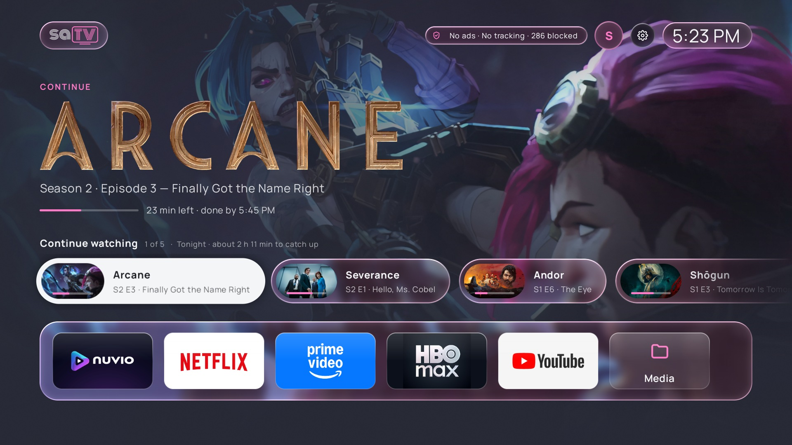
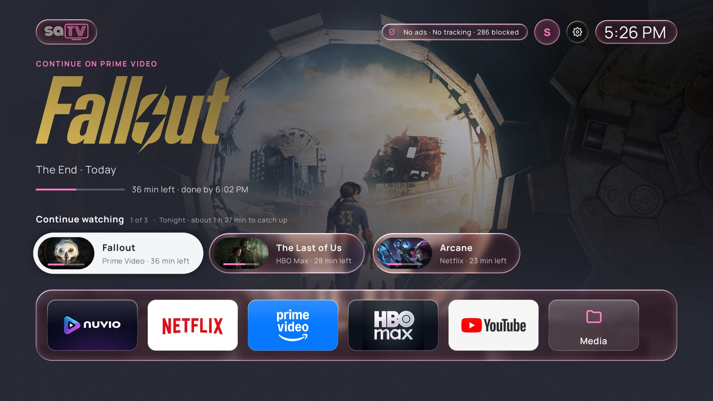
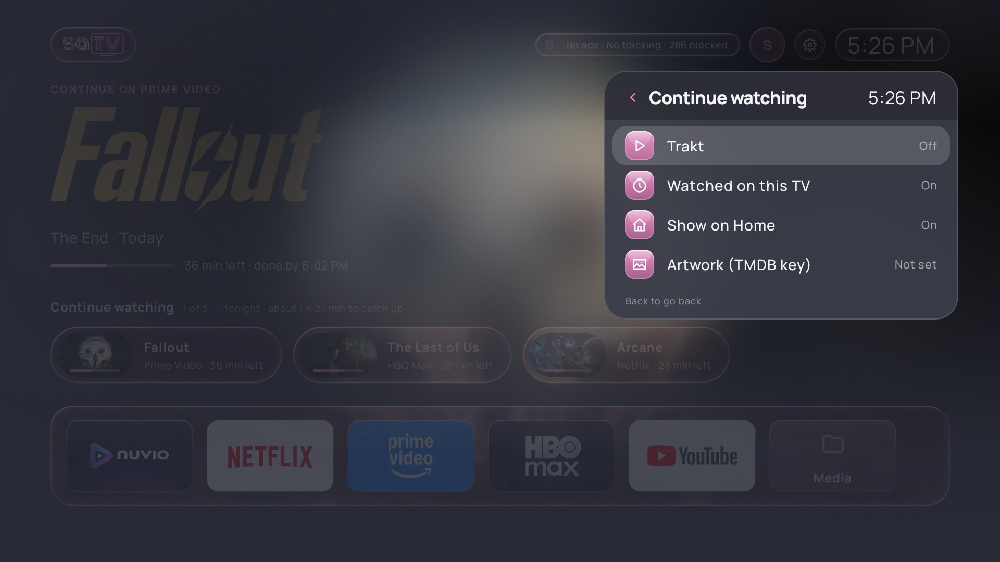
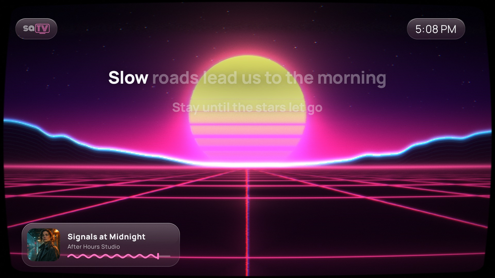
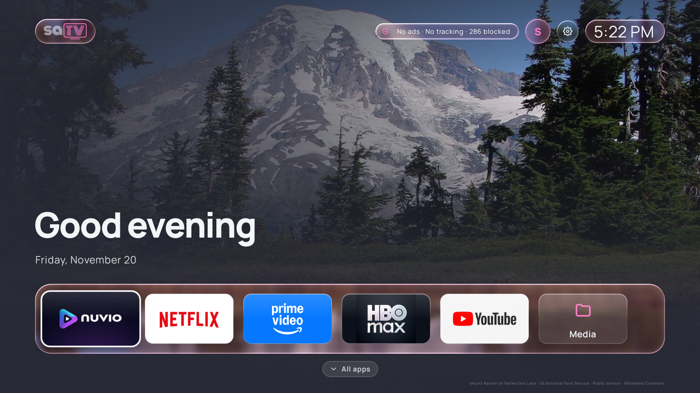

# saTV

**An ad-free, privacy-focused launcher for Android TV and Google TV.**

Pick up your next episode from a cinematic **Continue Watching** row with full-screen show artwork. Keep your favourite apps in a glass dock with animated folders, and give everyone their own profile and theme. When the TV goes idle, turn it into a parallax photo gallery or put your music on the big screen with **synced lyrics and seven audio-reactive visualizers**.

**Every saTV feature is free. No paid tiers or feature unlocks.**

No analytics or saTV account. Local watch history stays on your TV.

[Screenshots](#screenshots) · [Feature guide](#feature-guide) · [Install](#install) · [Permissions and privacy](#permissions-and-privacy)

*Captured in the Dracula theme on an Android TV demo setup.*

## Screenshots

### Continue Watching

Move across the row to change the full-screen backdrop, title logo, and episode details. **Trakt** can open an episode in Nuvio. **Watched on this TV** works with Trakt switched off and reopens the app that reported playback.

| **Trakt and title artwork** | **Local history with Trakt off** |
| --- | --- |
|  |  |

Episode details and source settings

| **Episode progress** | **Separate source switches** |
| --- | --- |
|  |  |

### Home, apps, and profiles

Press **Down** from the glass dock to open All Apps. Pin your favourites, group apps in animated folders, and hide apps per profile. Each profile can have its own dock, settings, and look.

| **All Apps** | **Animated folders** |
| --- | --- |
|  |  |

Profiles and appearance settings

| **Profile switcher** | **Theme, glass, and fonts** |
| --- | --- |
|  |  |

### Now Playing and synced lyrics

See the current track in the **Now Playing** chip on Home. Press **OK** for album art and playback controls. In Ambient, follow timed lyrics when available.

| **Now Playing chip** | **Synced lyrics** |
| --- | --- |
|  |  |

Expanded playback controls

### Aura music visualizer

Choose from seven audio-reactive looks: **Ribbons**, **Silk**, **Retro TV**, **Neon signal**, **Bubbles**, **Birds at dusk**, and **Waterfall**.

| **Retro TV** | **Ribbons** |
| --- | --- |
|  |  |

Waterfall visualizer

### Wallpapers and photo Ambient

Choose a rotating photo collection from Wikimedia Commons or NASA. Photo Ambient defaults to gentle parallax and has eight built-in photos for offline rotation.

| **Photo wallpapers** | **Photo Ambient** |
| --- | --- |
|  |  |

### Quick settings and DNS

The gear puts Wi-Fi, Bluetooth, Ambient, and optional system-wide DNS blocking within reach. With NextDNS set up, the stats panel shows blocked queries, top trackers, and a seven-day chart.

| **Quick settings** | **NextDNS dashboard** |
| --- | --- |
|  |  |

## Feature guide

- **Make your next episode the centrepiece.** Browse full-screen backdrops, title logos, progress, and time remaining right from Home. Use Trakt, local playback history from supported apps, or both. Trakt can open an episode in Nuvio. Add your own TMDB key under **Continue watching → Artwork**.
- **Put your favourite apps one press away.** Keep them in a glass dock with app icons or wide banners. Press **Down** to open All Apps and hold **OK** to pin, reorder, group, or hide apps. Restore hidden apps from **Settings → Hidden apps**.
- **Give everyone their own Home.** Switch profiles from the top-left button. Each profile can have its own dock, folders, hidden apps, wallpaper, theme, Trakt account, and local watch history. Add an optional PIN.
- **Make the idle screen worth looking at.** Rotate photos from Wikimedia Commons or NASA with parallax or slow zoom. Eight built-in photos keep rotating offline. When music is playing, Ambient can show synced lyrics or seven Aura visualizers. Use the Now Playing chip to control supported players from Home.
- **Tune the look and feel.** Pick from ten themes, change the font and dock size, and choose an interface sound or wake-up intro. Liquid glass adds depth on supported Android 13+ TVs. Frosted glass works on older TVs.
- **Keep the controls you use close by.** Open Wi-Fi, Bluetooth, and Ambient from the gear. Optional DNS blocking supports a timed pause or a per-app exception. A connected NextDNS account can show blocked queries, top trackers, and a weekly chart.
- **Save your setup.** Find manual and scheduled backups under **Settings → General** to save your profiles and launcher settings.

## Install

saTV runs on **Android TV and Google TV with Android 9 or newer**. The first public APK is in preparation. When it's available, you'll find it under [Releases](https://github.com/kcmaker10/satv/releases).

1. Download the signed APK and Google's Platform-Tools to a Windows, Mac, or Linux computer.
2. Connect your computer to the TV and install the APK with ADB.
3. Open saTV from your TV's apps. If you want the remote's **Home** button to open saTV, enable the Home button helper.

The [install guide](INSTALL.md) has exact commands, TV menu screenshots, troubleshooting, and the steps to restore your original Home.

## Permissions and privacy

The launcher, dock, folders, profiles, and photo Ambient are ready to try after installing. Turn on extra access for the features you use.

| Access | What it's for |
| --- | --- |
| **Accessibility** | The optional Home button helper detects the remote's Home press and the foreground app for features like per-app DNS pausing. |
| **Notification access** | Now Playing and local watch history receive playback metadata from Android media sessions. |
| **Microphone permission** | Android requires this permission for Aura's playback-audio effects. saTV uses the TV's audio output for the visualizer. |
| **Secure settings via ADB** | Optional system-wide DNS controls and automatic Home button helper repair. |
| **Location and nearby devices** | Optional access for showing the Wi-Fi network and connected Bluetooth device names. |

saTV has no launcher ads, analytics, or saTV account. Local playback history stays on the TV and can be cleared from Continue Watching. Trakt, artwork, wallpaper, weather, lyrics, and DNS features connect to their respective services when used. DNS blocking starts off.

## Credits

saTV builds on trbrnt's Veil, licensed under the GNU GPL v3. [Veil on GitHub](https://github.com/trbrnt/Veil) · [GPL v3](https://spdx.org/licenses/GPL-3.0-only.html)

- **Watch artwork and progress.** Artwork and logos use TMDB. Watch progress can be synced from Trakt. saTV is unaffiliated with either service. [TMDB](https://www.themoviedb.org) · [Trakt](https://trakt.tv)
- **Photos, lyrics, and weather.** Wallpaper credits appear on the TV. Timed lyrics come from LRCLIB, and weather from Open-Meteo. [Wikimedia Commons](https://commons.wikimedia.org) · [NASA Image Library](https://images.nasa.gov) · [LRCLIB](https://lrclib.net) · [Open-Meteo](https://open-meteo.com)
- **Theme and type.** The Dracula gallery uses the Dracula palette. saTV uses Manrope for the interface and Monoton for the wordmark. [Dracula](https://draculatheme.com) · [Manrope](https://github.com/sharanda/manrope) · [Monoton](https://fonts.google.com/specimen/Monoton)
